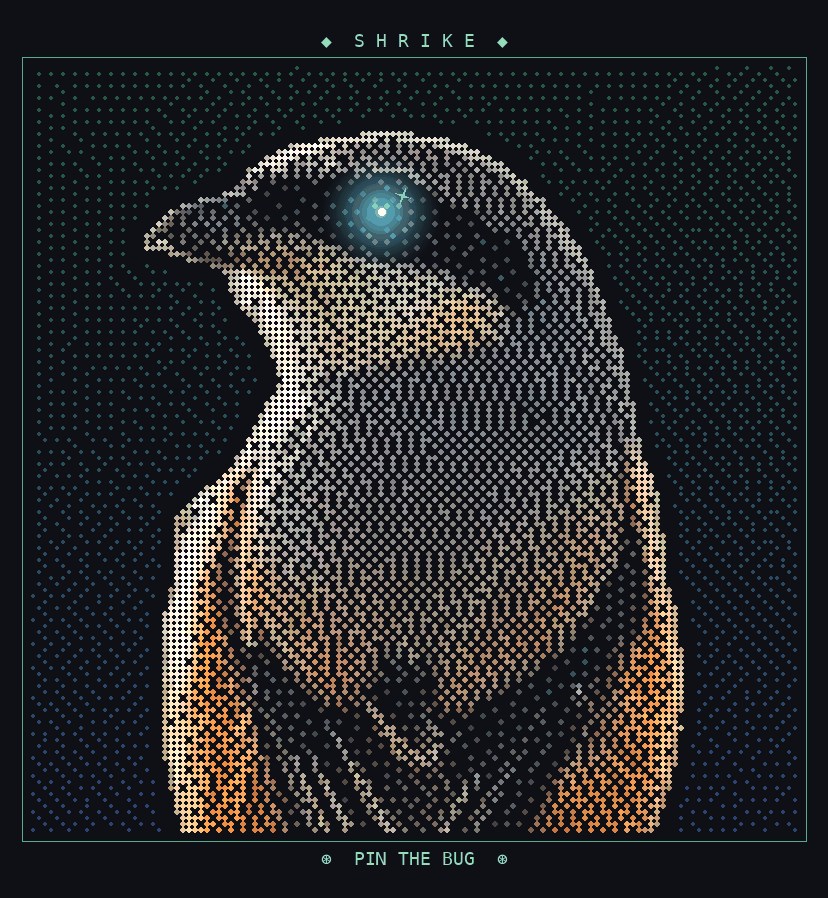

<p align="center">
  
</p>

<h1 align="center">Shrike</h1>

<p align="center"><b>Your app, recorded. Your agent, with eyes.</b></p>

<p align="center">
  An open source Agentic Debugging Environment for people who build web apps with AI.<br>
  Run your app inside Shrike, click the thing that breaks, and watch your own coding agent find the line, fix it with your OK, and prove the fix.
</p>

<p align="center">
  
</p>

## Why

You built an app with Cursor, Claude Code, Lovable or Bolt. It works until it doesn't. When a button does nothing, you paste the error into a chat and the model guesses from the code.

Shrike doesn't guess. It records what your app actually did when you clicked: the click, the request, every server function, the database query, the logs and the error, in order, each on the line of code that ran. Your agent reads that recording, so its answer points at a real line with the real bad value next to it.

## What it does

- **The Thread.** Every click becomes a trip drawn across lanes (you, page, server, database). The step that broke turns red, and Shrike dives into the code with the bad value inline, like `userId: undefined` on line 18.
- **Files view.** Press E to open the whole file inside Shrike on the line that ran, with the values that passed through it.
- **Agent fix, with approvals.** Ask in plain words. Your agent walks the trip, says "Found it" with the line and why, proposes a diff, and applies it only after you click. Then it re-runs the click to show it works.
- **API client.** A Bruno-style request editor: routes found for you, collections stored as files in your repo, imports from Bruno and OpenAPI, cURL in and out.
- **MCP hub.** Shrike's tools are an MCP server, so Claude Code or Cursor outside Shrike can read the same recordings. Add your own MCP servers too; their secrets go to the macOS keychain.
- **Skills that evolve.** Playbooks like "Bad value", "N+1 hunter" and "Slow page" guide the agent. When a run teaches it something new, Shrike offers to update the skill, and you see the change first.
- **Workspaces and worktrees.** Try a fix in a git worktree copy with its own ports and agent, or race two fixes side by side and keep the one that passes.
- **PR and CI.** Commit, push, open a pull request, read review comments and CI failures, and turn them into lessons. Anything that leaves your Mac asks first. Shrike never force-pushes.
- **Voice.** Hold Option Space and say "show the logs" or "next step". Speech runs on your Mac in a small helper app (English, Hindi and Hinglish tested).
- **Databases.** Look inside Postgres, MySQL, SQLite, MongoDB, Redis, DynamoDB, Firestore and Supabase from the lane that touched them, and see what each click changed.

Works today with Node servers (Express, Next.js, NestJS, Hono, Remix) and Vite or Next frontends. See [docs/14-compatibility.md](docs/14-compatibility.md) for the projects it was tested on.

## Quick start

### Download

1. Get `Shrike-<version>-arm64.dmg` from [Releases](https://github.com/SumantxD/shrike/releases).
2. Drag Shrike to Applications.
3. The app is signed but not notarised yet, so the first time, **right-click Shrike and choose Open**, then Open again. After that it opens normally.
4. Click **Open the sample project**, press **Run**, add a todo, and watch it break.

### Run from source

```sh
git clone https://github.com/SumantxD/shrike.git
cd shrike
pnpm i
pnpm dev
```

### Requirements

- macOS on Apple Silicon (voice needs macOS 15 or later)
- Node 24 (any Node from 22.18 runs your app; Shrike's own build uses 24)
- pnpm 10 for running from source, plus Xcode if you want voice (the helper builds on first use)
- [Claude Code](https://docs.claude.com/en/docs/claude-code) is optional. Shrike uses it on your own subscription when it's installed. Without it, the built-in agent runs on your own Anthropic API key, and the recording, Thread and API client work with no agent at all.

## How it works

```
your app (npm run dev)                     Shrike (Electron)
 ├ browser  ── browser-agent ──┐            ├ correlator: events -> one trip per click
 └ server   ── node-agent ─────┼─ ingest ─▶ ├ redact: secrets removed before anything is stored or shown
                               │            ├ store: SQLite + NDJSON in .shrike/
                               │            ├ the Thread, Files view, API client (React)
                               │            └ MCP server ◀── your agent (Claude Code, built-in, or any MCP client)
```

- `packages/browser-agent` runs in your page: clicks, fetches and React components with their source lines.
- `packages/node-agent` loads into your server with `--import`: functions, queries, logs and errors, tied to the request that caused them.
- `packages/correlator` joins both sides into one tree per click. `packages/mcp-server` hands it to agents as tools, with an approval gate on anything that changes code.
- `apps/desktop` is the Electron app. `apps/desktop/native/voice` is the Swift voice helper.

More in [docs/02-architecture.md](docs/02-architecture.md) and [docs/05-agent.md](docs/05-agent.md).

## Privacy

Shrike is local-first. Your code, recordings and secrets stay on your Mac.

- No telemetry, no account.
- Secrets are stripped from every recording before it is stored, shown, sent to an agent or exported.
- Agents can't edit files directly. Every change is a diff you approve.
- Shrike connects out only when you ask it to: your agent's own API, voice model downloads from Hugging Face, and GitHub through your `gh` login.

Details in [docs/07-security-privacy.md](docs/07-security-privacy.md).

## Roadmap

- Notarised builds and auto-update
- Windows and Linux
- Codex and OpenCode as agent brains
- Shareable recordings (`.shriketrace`) and a read-only web viewer
- More stacks: Vite SSR, SvelteKit, Nuxt, Python and FastAPI

The full plan is in [docs/08-roadmap.md](docs/08-roadmap.md).

## Contributing

Issues and pull requests are welcome.

1. Read [CLAUDE.md](CLAUDE.md) for the working rules (they apply to people too) and [MASTER_PROMPT.md](MASTER_PROMPT.md) for the product brief.
2. `pnpm test` runs the unit checks. `pnpm e2e` builds the app and runs the Playwright end-to-end tests ([docs/09-testing.md](docs/09-testing.md)).
3. Keep diffs small, keep `docs/` true, and follow `design-system/` for anything visual.

Releasing a build: [docs/RELEASING.md](docs/RELEASING.md).

## License

[MIT](LICENSE). Copyright (c) 2026 Sumant Tirkey.
