<p align="center">
  <picture>
    <source media="(prefers-color-scheme: light)" srcset="docs/media/banner-light.webp">
    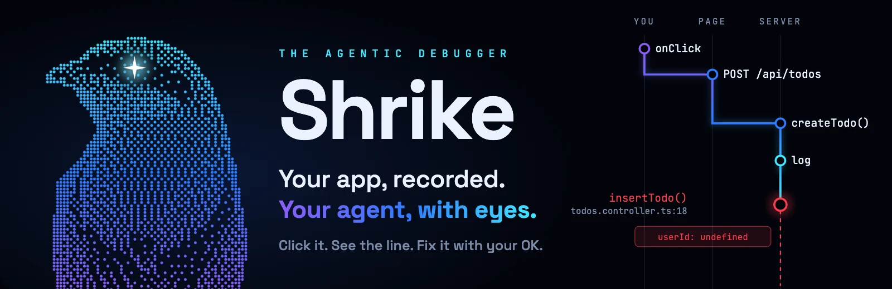
  </picture>
</p>

<p align="center">
  <a href="https://github.com/SumantxD/shrike/releases/latest"></a>
  
  <a href="https://github.com/SumantxD/shrike/actions/workflows/ci.yml"></a>
  <a href="LICENSE"></a>
  <a href="https://github.com/SumantxD/shrike/stargazers"></a>
  
</p>

<h3 align="center">The open source debugger for people who build web apps with AI.</h3>

<p align="center">
  You still just ask your agent to fix it. The difference: it sees what your app actually did.<br>
  Click the thing that breaks, Shrike records the whole trip from the button to the database,<br>
  and your agent fixes the real line on the first try, after you say OK, then clicks again to prove it.
</p>

<p align="center"><sub>Works with Node backends (Express, Next.js, NestJS, Hono, Remix), Python 3.12+ backends (FastAPI, Flask, Django) and Vite or Next frontends. Any other backend that speaks OpenTelemetry (.NET, Go, Java, older Python) gets basic tracing.</sub></p>

<p align="center">
  <a href="https://github.com/SumantxD/shrike/releases/latest"><b>Download for Mac</b></a> ·
  <a href="#quick-start"><b>Quick start</b></a> ·
  <a href="#what-happens-when-you-click"><b>Walkthrough</b></a> ·
  <a href="#how-it-works"><b>How it works</b></a> ·
  <a href="docs/01-product.md"><b>Docs</b></a>
</p>

<p align="center">
  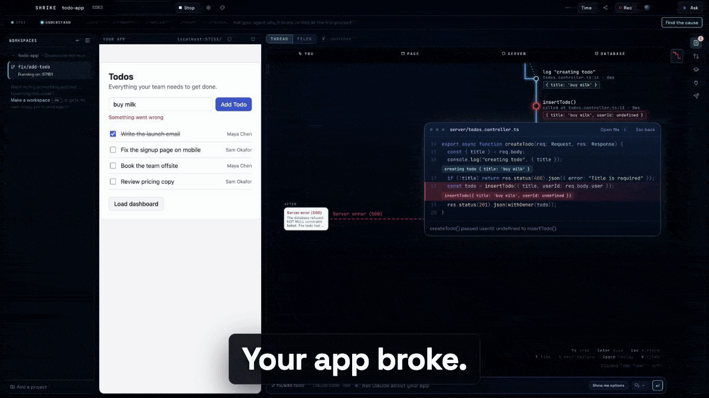
</p>

<p align="center">
  <a href="https://youtu.be/z_9tfvs3_jU">
    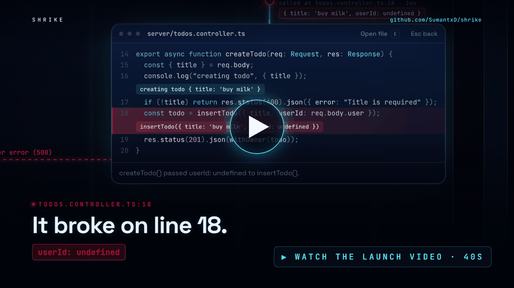
  </a>
  <br>
  <sub>Watch the 40 second launch video on YouTube</sub>
</p>

## Why Shrike

You built an app with Cursor, Claude Code, Lovable or Bolt. It works until it doesn't. A button does nothing, so you paste the error into a chat and the model guesses from the code. On a small app that's often fine. On a bigger codebase, with a team and flows that can't break, the agent loops on wrong fixes because it can't see what ran.

<table>
<tr>
<th width="50%">Without Shrike</th>
<th width="50%">With Shrike</th>
</tr>
<tr>
<td valign="top">

- You copy logs from three terminals
- You guess which request it was
- The model reads code and guesses
- "Try this" until something sticks

</td>
<td valign="top">

- One click is recorded end to end
- The broken step turns red, on its line
- The agent reads what really ran, with the bad value
- It shows a diff, you approve, it re-runs the click

</td>
</tr>
</table>

**Shrike is for you if**

- You build with AI and can run `npm run dev`, but stack traces still feel like guesswork
- You want to see what your code did when you clicked, not read 40 files to find out
- You want your agent to fix things with proof, and never touch a file without asking

## What happens when you click

**1. Click. The trip draws itself and stops where it broke.**
Every click becomes a trip across lanes: you, page, server, database. The step that failed turns red, and Shrike dives into the code with the real value inline, like `userId: undefined` on line 18.

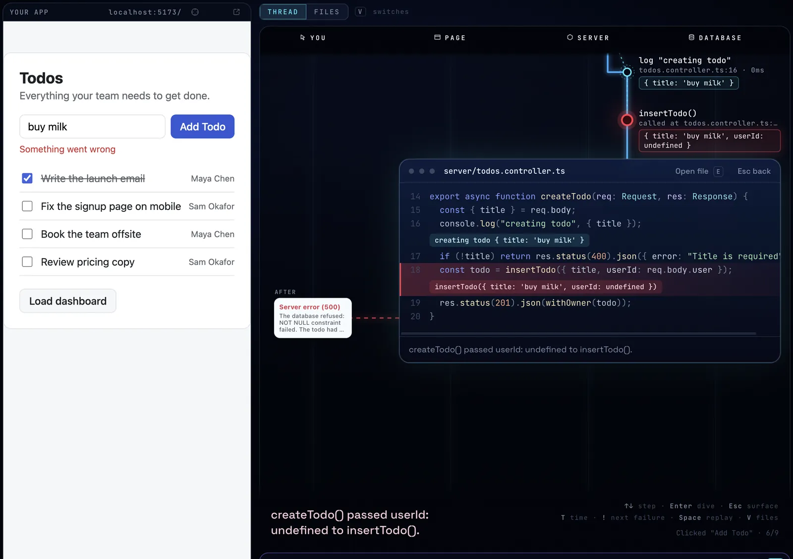

**2. Press E. See the whole file, and every file the click touched.**
The Files view opens on the line that ran, next to a tree of every file in the trip. Hot rows ran, red rows broke. The strip at the bottom is the call path you can scrub.

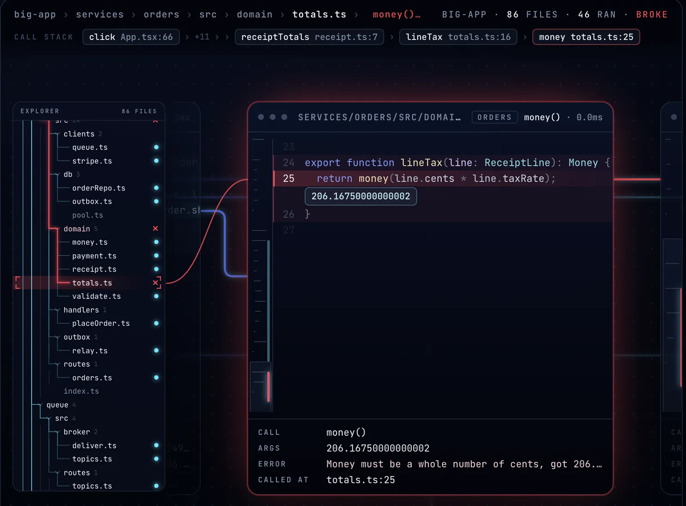

**3. Ask in plain words. Your agent says "Found it".**
Type "when I click Add Todo nothing shows up". The agent walks the recorded trip, pins the cause on a line, and says why in one sentence. You see which playbook it used.

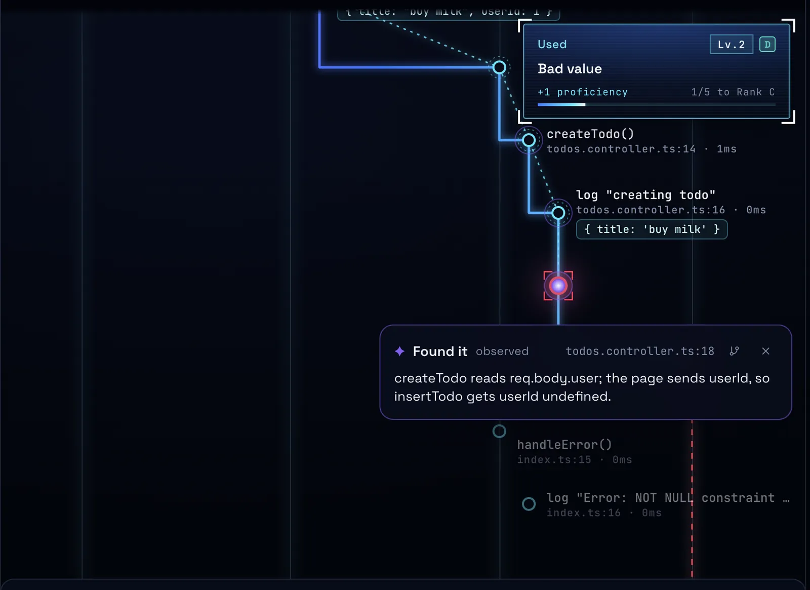

**4. Approve the diff. Then ship it.**
The fix lands only after your click, and Shrike replays the same click to show it passes. Commit, open a pull request, and read CI failures and review comments in the same window.

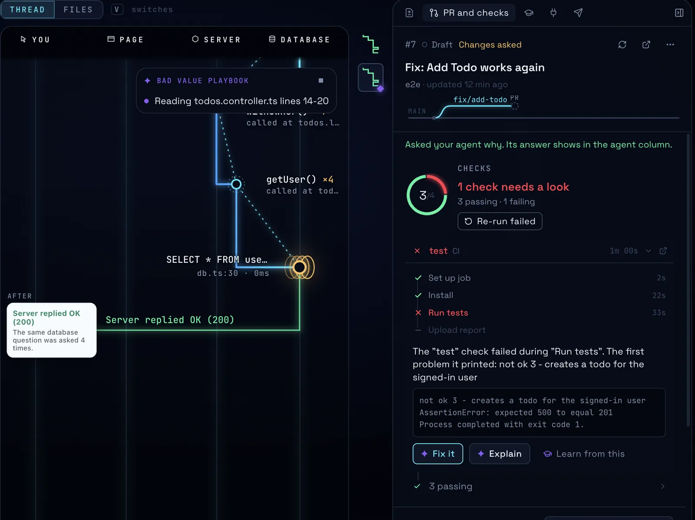

## Features

<table>
<tr>
<td width="50%" valign="middle">

### Any stack, any size

A click in Bazaar, the big sample app, crosses 8 services, 3 Postgres databases, an SQLite outbox, 3 LRU caches, a queue, Stripe and an email provider. Shrike finds the lanes by itself and still stops on the one bad line.

Postgres, MySQL, SQLite, MongoDB, Redis, DynamoDB, Firestore, Supabase. [Tested projects →](docs/14-compatibility.md)

</td>
<td width="50%">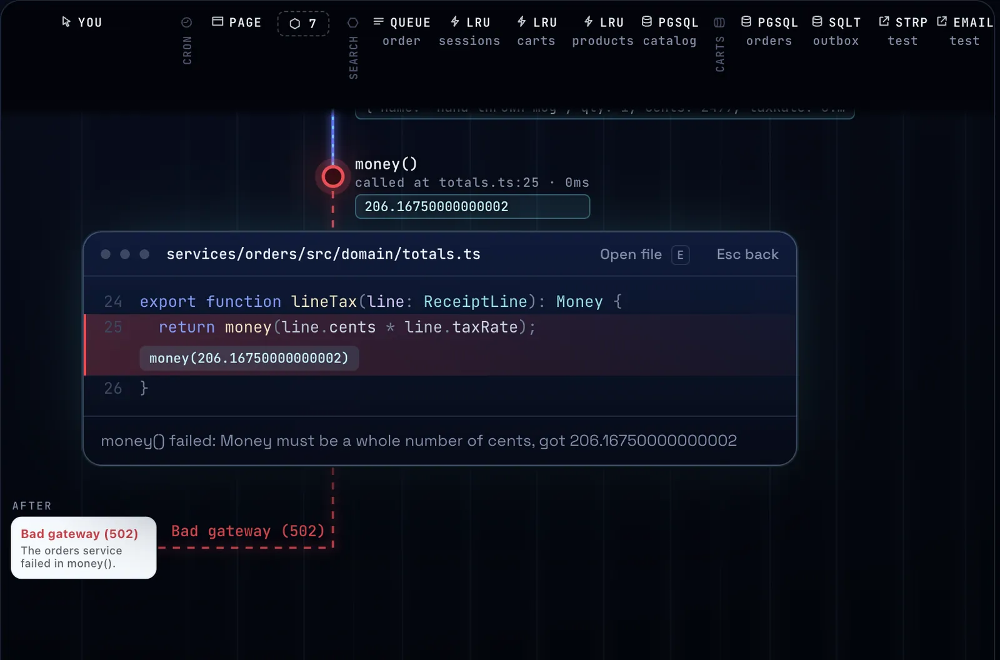</td>
</tr>
<tr>
<td width="50%" valign="middle">

### API client

A Bruno-style request editor. Routes are found for you, collections are plain files in your repo, and you can import from Bruno, OpenAPI and cURL. Every request you send becomes a trip, so you see what the server did with it.

</td>
<td width="50%">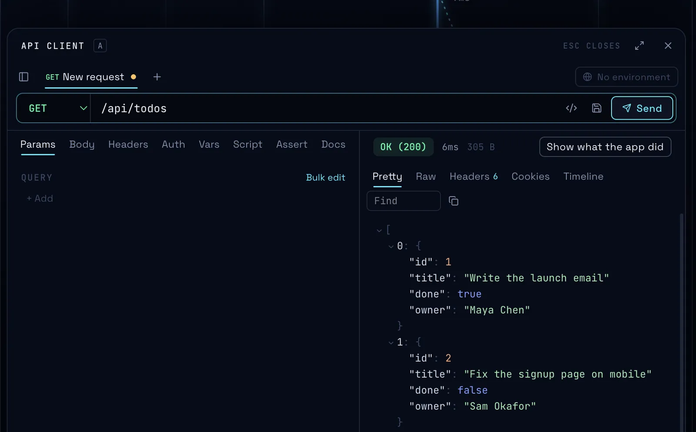</td>
</tr>
<tr>
<td width="50%" valign="middle">

### Workspaces and worktrees

Try a fix in a git worktree copy with its own ports and its own agent. Race two fixes side by side and keep the one that passes. Many projects, one rail.

[Docs →](docs/13-skills-worktrees-sdlc.md)

</td>
<td width="50%">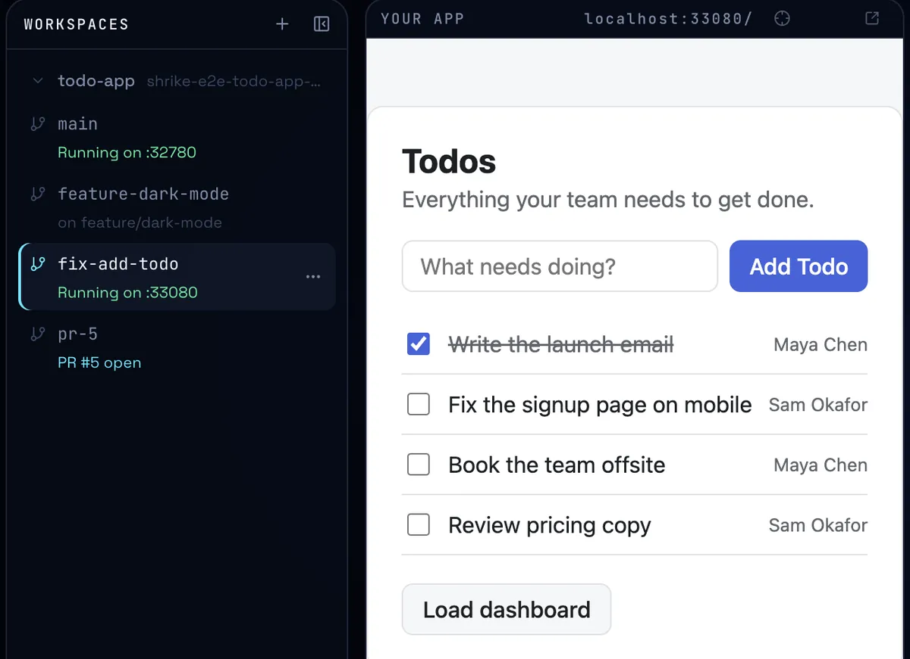</td>
</tr>
</table>

<table>
<tr>
<td width="33%" valign="top">

**The Thread**<br>Each click as a trip across lanes, with timings, values and the line of code for every step.

</td>
<td width="33%" valign="top">

**Files view**<br>The real files, open on the line that ran, with the values that passed through it.

</td>
<td width="33%" valign="top">

**Agent fix, with approvals**<br>Found it, a diff, your click, a replay. Agents can't write files on their own.

</td>
</tr>
<tr>
<td valign="top">

**Skills that evolve**<br>Playbooks like "Bad value" and "N+1 hunter". When a run teaches something, the skill updates after the fix is verified, with one-click Undo.

</td>
<td valign="top">

**PR and CI**<br>Commit, push, open a PR, read checks and reviews, turn failures into lessons. Anything that leaves your Mac asks first.

</td>
<td valign="top">

**MCP hub**<br>Shrike's tools are an MCP server: paste one line and the Claude Code in your terminal reads the same recordings, and still changes code only after you click Apply. Add your own servers too.

</td>
</tr>
<tr>
<td valign="top">

**Voice**<br>Hold Option+Space and say "show the logs" or "next step". Speech runs on your Mac. English, Hindi and Hinglish tested.

</td>
<td valign="top">

**Look inside your data**<br>Click a database or cache lane to see its tables or keys, and what this click changed.

</td>
<td valign="top">

**Local and private**<br>No account, no telemetry. Secrets are stripped before anything is stored, shown or sent.

</td>
</tr>
</table>

Works today with Node servers (Express, Next.js, NestJS, Hono, Remix), Python 3.12+ servers (FastAPI, Flask, Django) and Vite or Next frontends. On Python, Shrike records every call into your own code with its arguments, what it returned and its file and line, nested under the request that caused it, plus its sqlite3 queries, with no change to your code ([packages/python-agent](packages/python-agent)). Any backend that speaks OpenTelemetry (.NET, Go, Java, Python before 3.12) works with basic tracing: its requests, queries and outside calls show up, but not per-function values. Shrike points the app's OpenTelemetry SDK at itself when it runs the app; see [fixtures/py-app](fixtures/py-app) for FastAPI, Flask and Django examples.

## Quick start

### Download

1. Get `Shrike-<version>-arm64.dmg` from [Releases](https://github.com/SumantxD/shrike/releases/latest) and drag Shrike to Applications.
2. Open Shrike. The build is signed and notarised by Apple, so it opens like any other app.
3. Click **Open the sample project**, press **Run**, add a todo, and watch it break.

**Linux** (x64, arm64): there is no released build yet. Build an AppImage or `.deb` with `scripts/release/build-linux.sh` (see [docs/RELEASING.md](docs/RELEASING.md)), or take the AppImage from the `shrike-linux-x64` artifact of a CI run. Voice is macOS only. On NixOS, run the AppImage with `appimage-run`. **Windows** builds from the same config but hasn't been run on a Windows machine yet ([docs/14-compatibility.md](docs/14-compatibility.md#operating-systems)).

### Run from source

```sh
git clone https://github.com/SumantxD/shrike.git
cd shrike
pnpm i
pnpm dev
```

### Use it from Claude Code

Install the plugin and the Claude Code in your terminal reads Shrike's recordings while Shrike is open:

```
/plugin marketplace add SumantxD/shrike
/plugin install shrike@shrike
```

It adds Shrike's tools, a debugging skill, the latest trip in a line above the prompt and `/shrike`. Code still changes only after you click Apply in Shrike. See [integrations/claude-code](integrations/claude-code/README.md). For Cursor or another MCP client, copy the one-line setup from Shrike's Tools panel instead.

<details>
<summary><b>Requirements</b></summary>

- macOS on Apple Silicon (voice needs macOS 15 or later). Linux runs from source or a CI build, without voice
- Node 24 (any Node from 22.18 runs your app; Shrike's own build uses 24)
- pnpm 10 for running from source, plus Xcode if you want voice (the helper builds on first use)
- [Claude Code](https://docs.claude.com/en/docs/claude-code) is optional. Shrike uses it on your own subscription when it's installed. Without it, the built-in agent runs on your own Anthropic API key, and the recording, Thread and API client work with no agent at all.

</details>

## How it works

<p align="center">
  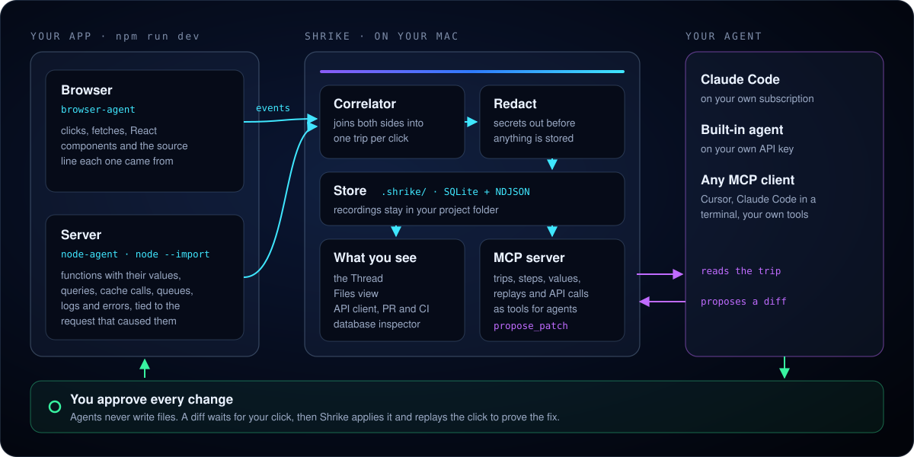
</p>

- `packages/browser-agent` runs in your page: clicks, fetches and React components with their source lines.
- `packages/node-agent` loads into your server with `--import`: functions, queries, logs and errors, tied to the request that caused them.
- `packages/correlator` joins both sides into one tree per click. `packages/mcp-server` hands it to agents as tools, with an approval gate on anything that changes code.
- `apps/desktop` is the Electron app. `apps/desktop/native/voice` is the Swift voice helper.

More in [docs/02-architecture.md](docs/02-architecture.md) and [docs/05-agent.md](docs/05-agent.md).

## How it compares

|  | Shrike | Browser devtools | Sentry | Postman / Bruno | Claude Code on its own |
|---|:---:|:---:|:---:|:---:|:---:|
| Page, server and database in one trip per click | ✅ | Page only | Traces, with an SDK | Request only | ❌ |
| Real values on the line that ran | ✅ | Page, with breakpoints | On errors | ❌ | ❌ |
| Agent fix you approve, then a replay to prove it | ✅ | ❌ | Paid AI add-on | ❌ | Fixes from reading code |
| Runs on your machine, no account | ✅ | ✅ | Cloud or self-host | Bruno yes, Postman needs an account | ✅ |
| Production monitoring | ❌ | ❌ | ✅ | ❌ | ❌ |

Shrike is for building and debugging on your Mac. For errors in production, keep Sentry.

## Privacy

- No telemetry, no account. Your code, recordings and secrets stay on your Mac.
- Secrets are stripped from every recording before it is stored, shown, sent to an agent or exported.
- Agents can't edit files directly. Every change is a diff you approve.
- Shrike connects out only when you ask: your agent's own API, voice model downloads from Hugging Face, and GitHub through your `gh` login.

Details in [docs/07-security-privacy.md](docs/07-security-privacy.md).

## Roadmap

- [x] Notarised builds
- [ ] Auto-update
- [ ] Windows and Linux releases (Linux builds from source today)
- [ ] Codex and OpenCode as agent brains
- [ ] Shareable recordings (`.shriketrace`) and a read-only web viewer
- [x] Function steps for Python 3.12+ (FastAPI, Flask, Django)
- [ ] More stacks: Vite SSR, SvelteKit, Nuxt, function steps for other OpenTelemetry backends

The full plan is in [docs/08-roadmap.md](docs/08-roadmap.md).

## Contributing

Shrike is built in the open and contributions are welcome, from a bug report to a new stack.

- **Start here:** [CONTRIBUTING.md](CONTRIBUTING.md) covers setup, the rules and how pull requests are reviewed.
- **Pick something up:** [good first issues](https://github.com/SumantxD/shrike/labels/good%20first%20issue) and [help wanted](https://github.com/SumantxD/shrike/labels/help%20wanted).
- **Ask, share or propose:** [Discussions](https://github.com/SumantxD/shrike/discussions).
- **Found a bug or need your stack?** [Open an issue](https://github.com/SumantxD/shrike/issues/new/choose).

What changed in each version is in [CHANGELOG.md](CHANGELOG.md). Everyone follows the [Code of Conduct](CODE_OF_CONDUCT.md), and security problems go through [SECURITY.md](SECURITY.md).

## Star history

<a href="https://star-history.com/#SumantxD/shrike&Date">
  <picture>
    <source media="(prefers-color-scheme: dark)" srcset="https://api.star-history.com/svg?repos=SumantxD/shrike&type=Date&theme=dark">
    
  </picture>
</a>

## License

[MIT](LICENSE). Copyright (c) 2026 Sumant Tirkey.

<p align="center">
  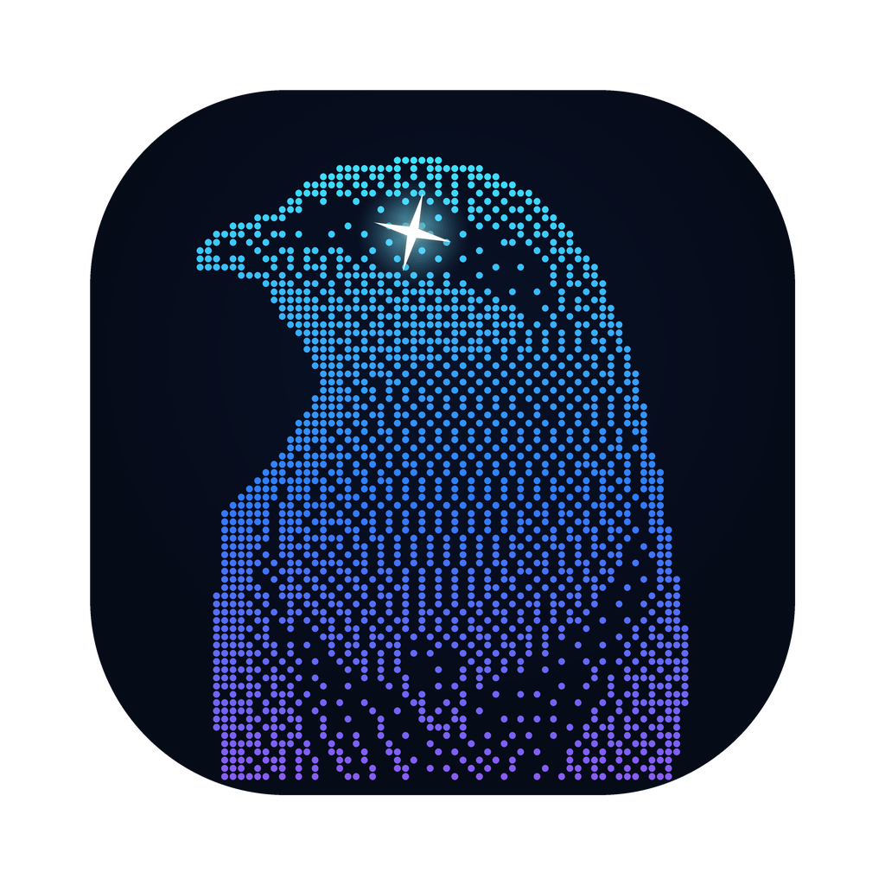<br>
  <sub>A shrike finds the bug and pins it to the thorn.</sub>
</p>
